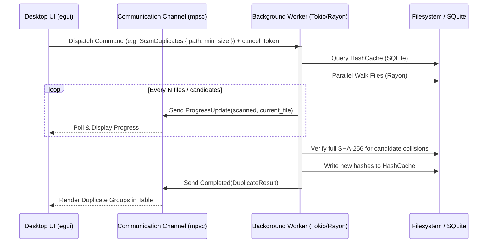
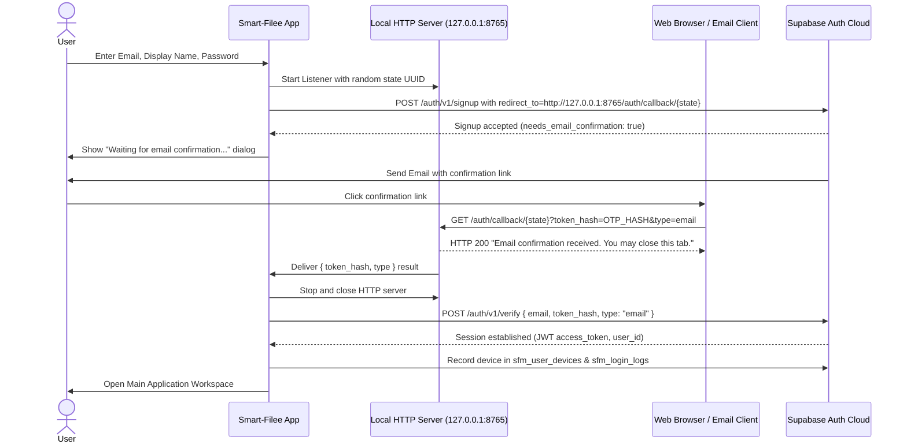

# Smart-Filee — Data Flow & Lifecycle Specification

---

## 1. Asynchronous Execution & Progress Reporting Flow

All heavyweight operations follow a standardized asynchronous actor/worker data flow:



---

## 2. Destructive Operation & Undo Journal Lifecycle

Every move, rename, cleanup, or organize action strictly adheres to this 8-step lifecycle:

```
1. SCAN & COLLECT
   Target files collected based on user configuration.
          │
2. PATH VALIDATION
   Validate that source and destination are not filesystem roots or OS system folders.
          │
3. PREVIEW GENERATION
   Pre-calculate planned changes and collision resolutions.
          │
4. USER CONFIRMATION
   Present preview table and obtain user confirmation.
          │
5. TRANSACTION JOURNALING
   Begin SQLite transaction: insert row into `undo_batches` with status 'active'.
   Insert planned (src, dst) rows into `undo_moves`.
   Commit SQLite transaction.
          │
6. ATOMIC EXECUTION
   Execute physical file moves using deterministic unique names.
   Log unreadable/locked file errors without aborting entire batch.
          │
7. RE-EVALUATE & CLEANUP
   Prune empty created category/month directories if operations were reverted.
          │
8. LOG & VERIFY
   Append entry to `activity_log`. Update in-memory undo stack.
```

---

## 3. Supabase Email Confirmation Loopback Flow


