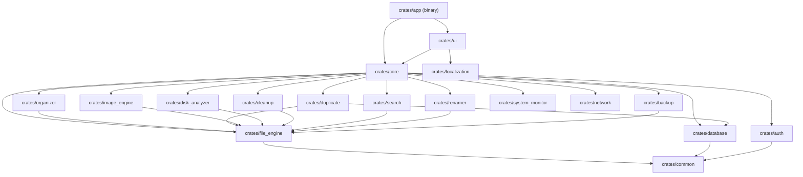

# Smart-Filee — Rust System Architecture Specification

**Project:** Smart-Filee  
**Target Platform:** Windows 10/11 (Primary), macOS / Linux (Supported)  
**Language:** Rust (Stable 1.80+)  
**UI Framework:** `egui` (0.28+) / `eframe`  
**Async Engine:** Tokio  
**Parallel Processing:** Rayon  
**Database:** SQLite (`rusqlite`) with WAL mode  
**Cloud Auth:** Supabase Auth REST API (`reqwest`)  

---

## 1. Architectural Principles & Layered Design

To guarantee performance, maintainability, memory safety, and complete UI responsiveness, the Rust architecture is strictly partitioned into four concentric layers:

```
┌────────────────────────────────────────────────────────┐
│                   PRESENTATION LAYER                   │
│   (egui / eframe GUI, Views, Widgets, Theme, Dialogs)  │
└───────────────────────────▲────────────────────────────┘
                            │ Channels (mpsc / flume)
                            │ State snapshots & Command events
┌───────────────────────────▼────────────────────────────┐
│               APPLICATION / SERVICE LAYER              │
│  (ScanCoordinator, BatchManager, AuthSession, Watcher) │
└───────────────────────────▲────────────────────────────┘
                            │ Method calls / In-memory domain objects
┌───────────────────────────▼────────────────────────────┐
│                      DOMAIN LAYER                      │
│ (FileMetadata, DuplicateGroup, PerceptualHash, Rules)  │
└───────────────────────────▲────────────────────────────┘
                            │ Interfaces & Storage traits
┌───────────────────────────▼────────────────────────────┐
│                  INFRASTRUCTURE LAYER                  │
│ (SQLite rusqlite, Filesystem std::fs, Sysinfo, Reqwest)│
└────────────────────────────────────────────────────────┘
```

### 1.1 Non-Blocking UI Invariant
The UI thread executes purely immediate-mode rendering and event collection. Under no circumstances may the UI thread block on:
- Filesystem traversal (`walkdir`)
- Cryptographic or perceptual hashing (`sha2`, `image`)
- Network requests (`reqwest`, DNS, ping)
- SQLite disk transactions

All heavy background operations are dispatched to the Tokio async runtime or Rayon thread pool and report incremental progress and cancellation status across bounded cross-thread communication channels (`tokio::sync::mpsc` or `crossbeam-channel`).

---

## 2. Multi-Crate Workspace Layout

The application is structured as a modular Cargo workspace in `crates/`:

```text
Smart-Filee/
├── Cargo.toml                      # Workspace root manifest
├── Cargo.lock
├── rust-toolchain.toml             # Pinned stable Rust toolchain
├── AGENT.md                        # Master development specification
├── README.md                       # Bilingual project documentation
├── crates/
│   ├── app/                        # Binary entry point, CLI flags, lifecycle management
│   ├── ui/                         # eframe/egui GUI, 14 page views, custom painter widgets
│   ├── core/                       # Orchestration service layer, tidy score, health summary
│   ├── common/                     # Shared types, error handling (thiserror/anyhow), path utilities
│   ├── file_engine/                # Safe path guards, traversal, unique dest, atomic moves, undo
│   ├── organizer/                  # Organization planning, rule engine, date bucketing
│   ├── duplicate/                  # Size grouping, 64KB head hash, full SHA-256 detection
│   ├── image_engine/               # EXIF parser, 3-way perceptual hashing (dhash/ahash), union-find
│   ├── disk_analyzer/              # Disk scanner, category aggregation, bounded top 100 heap
│   ├── cleanup/                    # Temporary patterns, old large files, empty directory pruning
│   ├── search/                     # Pattern search, glob wildcards, size filters
│   ├── renamer/                    # Bulk rename transformer, collision analysis, batch applier
│   ├── backup/                     # One-way differential file copy, directory tree sync
│   ├── system_monitor/             # CPU, RAM, disk usage, read-only process listing via sysinfo
│   ├── network/                    # Local IPv4 detection, ping subprocess, TCP port scanner
│   ├── database/                   # SQLite schema, WAL mode, undo journal, hash cache, logs
│   ├── auth/                       # Supabase Auth client, loopback email callback, device logging
│   └── localization/               # Bilingual dictionary, string formatting, progress regex
├── assets/                         # Application icon, logo SVGs
├── fonts/                          # Bundled Instrument Sans & Thai font assets
├── migrations/                     # SQLite schema migration scripts
└── tests/                          # Integration, regression, and cross-crate test suite
```

---

## 3. Crate Responsibilities & Inter-Dependencies



---

## 4. Concurrency & Memory Management Strategy

### 4.1 Concurrency Model
1. **Tokio Async Runtime:** Dedicated to I/O-bound background jobs (HTTP requests to Supabase, TCP socket checks, DNS resolutions, folder watch events via `notify`).
2. **Rayon Thread Pool:** Dedicated to CPU-bound parallel workloads (multithreaded SHA-256 checksum computation, perceptual image hash generation, batch disk statistics). Work-stealing prevents thread starvation.
3. **Atomic Progress & Cancellation:** Long-running operations take an `Arc<AtomicBool>` cancellation token. Iterators test `cancel.load(Ordering::Relaxed)` frequently and abort cleanly without leaving partial or corrupted files.

### 4.2 Bounded Memory Model
- **Streaming Filesystem Hashing:** Files are read in 1 MB bounded buffer chunks (`[u8; 1048576]`). No entire file is ever loaded into memory, regardless of size.
- **Image Fingerprinting:** Images are decoded directly into grayscale 9x9 thumbnail buffers (`image::imageops::resize`). Full-resolution pixel data is immediately dropped.
- **Top 100 Heap:** Disk analysis maintains a fixed-capacity binary min-heap (`std::collections::BinaryHeap`) of at most 100 elements, preventing memory exhaustion when indexing millions of files.

---

## 5. UI/UX & Localization Architecture

### 5.1 egui / eframe Custom Styling
- **Theme Palette:** Implements the exact Premium Light Violet color specifications:
  - Background: `#F7F6FC`
  - Sidebar: `#FFFFFF`
  - Panels/Cards: `#FFFFFF` (Secondary: `#F1EEFA`)
  - Text: `#24213A` (Muted: `#77738F`)
  - Accent / Primary Buttons: `#7657E8` (Hover: `#6243D2`, Selected: `#EAE4FF`)
  - Border: `#E7E2F2`
- **Font Stack:** Configured in `eframe::CreationContext` using `epaint::text::FontDefinitions`:
  - Primary Latin: `Instrument Sans` (bundled TTF).
  - Primary Thai: `Leelawadee UI` (Windows native) / `Noto Sans Thai` (bundled fallback).
  - Monospace: `Consolas` / `Courier New`.

### 5.2 Localization
- The `crates/localization` crate provides a zero-allocation translation interface:
  ```rust
  pub fn tr(key: &str) -> &'static str;
  pub fn tr_fmt(key: &str, args: &[(&str, &str)]) -> String;
  ```
- Translation keys are validated at compile-time / test-time to ensure 100% parity between English and Thai catalogs.

---

## 6. Security & Data Protection Architecture

1. **Zero Secret Leakage:** Client binaries only ever contain the Supabase publishable key. Configuration loading from `.env` checks for and explicitly rejects `service_role` and secret key prefixes.
2. **Path Sanitization:** The `crates/file_engine::security` module canonicalizes all user-supplied paths and validates them against system roots (`C:\`, `/`) and system directories before executing any rename, move, or delete.
3. **Collision Resistance:** Destination generation follows deterministic `unique_dest` logic (`stem (n).ext`), preventing accidental overwrites.
4. **Operation Journaling:** Every destructive or mutating file operation generates a serialized `UndoBatch` with individual `UndoMove` records committed to SQLite prior to execution.
