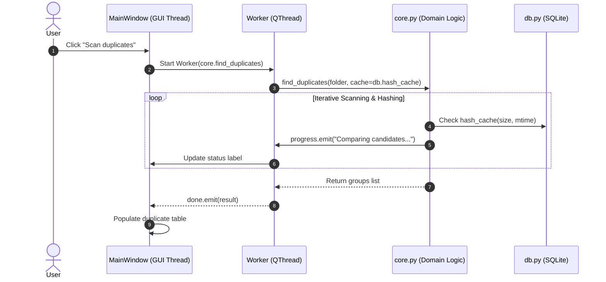
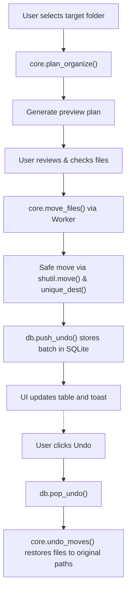

# Smart File Manager Pro — System Architecture

**Document Version:** 1.0.0
**Date:** 2026-11-10
**Author:** Software Architecture Team
**Status:** Approved

---

## 1. High-Level Architectural Overview

Smart File Manager Pro is a local-first, privacy-preserving desktop application for cross-platform file management and system maintenance. It follows a multi-tier architectural pattern that decouples GUI presentation, pure-Python domain business logic, local transactional database storage, and cloud identity management.

```mermaid
graph TD
    subgraph UI ["Presentation Layer (PySide6)"]
        MW["MainWindow (app.py)"]
        WID["Custom Widgets (widgets.py)"]
        TH["Theme Engine (themes.py)"]
        TR["i18n Translation (i18n.py)"]
        AUTH_UI["Auth Dialog (auth_dialog.py)"]
        ACC_UI["Account Dialog (account_dialog.py)"]
    end

    subgraph WORKERS ["Asynchronous Worker Layer"]
        QW["Worker Thread (QThread)"]
        FSW["QFileSystemWatcher"]
    end

    subgraph DOMAIN ["Core Domain Logic (Pure Python - No Qt)"]
        ORG["File Organizer (core.py)"]
        DUP["Duplicate Finder (core.py)"]
        SIM["Similar Photos (core.py)"]
        CLN["Disk Cleanup (core.py)"]
        REN["Bulk Renamer (core.py)"]
        BCK["Differential Backup (core.py)"]
        DSK["Disk Analyzer (core.py)"]
        NET["Network Tools (core.py)"]
        CRASH["Crash Handler (crash.py)"]
    end

    subgraph STORAGE ["Local Storage Layer (Zero Telemetry)"]
        SQL["SQLite Database (db.py - sfm.db)"]
        UB["undo_batches / undo_moves"]
        LOGS["activity_log"]
        HC["hash_cache"]
        SH["scan_history"]
        RULES["custom_rules"]
    end

    subgraph CLOUD ["Cloud Identity Layer (HTTPS)"]
        SUPA_CLI["Supabase Client (membership_client.py)"]
        CALLBACK["Loopback Server (127.0.0.1:8765)"]
        POSTGRES["Supabase Auth & RLS Tables"]
    end

    MW --> WID
    MW --> TH
    MW --> TR
    MW --> AUTH_UI
    MW --> ACC_UI
    MW --> QW
    MW --> FSW

    QW --> ORG
    QW --> DUP
    QW --> SIM
    QW --> CLN
    QW --> REN
    QW --> BCK
    QW --> DSK
    QW --> NET

    MW --> SQL
    DUP --> HC
    ORG --> RULES
    MW --> UB
    MW --> LOGS

    AUTH_UI --> SUPA_CLI
    ACC_UI --> SUPA_CLI
    SUPA_CLI --> CALLBACK
    SUPA_CLI --> POSTGRES
```

---

## 2. Architectural Subsystems

### 2.1 Presentation Layer (`app.py`, `widgets.py`, `themes.py`, `i18n.py`)
- **`MainWindow`:** Central coordinator. Manages view switching between 14 functional pages (Dashboard, Organizer, Disk Analyzer, Duplicate Finder, Similar Photos, Cleanup, File Search, Bulk Renamer, Backup, Processes, Network Tools, System Info, Activity Log, Settings).
- **Custom Widget Library (`widgets.py`):**
  - `Ring`: Custom QPainter widget displaying the 0-100 Tidiness score.
  - `BarList`: Normalized visual bar charts for folder sizes and file type distribution.
  - `Card`, `StatCard`: Standardized container cards with rounded corners.
  - `Toast`: Non-blocking, self-dismissing status feedback overlay.
  - `DropLineEdit`: Native drag-and-drop file/directory path input.
- **Theme Engine (`themes.py`):** Dynamic QSS injection supporting 6 color palettes (Steam, Neon Violet, Cyber Cyan, Crimson Night, Premium Light Violet, Light).
- **Internationalization (`i18n.py` & `i18n_th.py`):** Dynamic runtime localization between English and Thai (`tr()`).

### 2.2 Asynchronous Worker & Concurrency Model
To prevent UI blocking during heavy file operations (SHA-256 calculation, directory walks, perceptual image hashing):
- `Worker(QThread)` executes arbitrary functions off the Qt GUI thread.
- Standardized signals:
  - `progress(str)`: Emits real-time progress text (e.g., "Scanning 1,500 files…").
  - `done(object)`: Delivers the final computation result to the main thread.
  - `failed(str)`: Delivers caught exceptions safely without crashing the UI.
- All domain functions accept a `cancel: Callable[[], bool]` token for immediate cooperative cancellation.

### 2.3 Core Domain Subsystem (`core.py`)
- **Qt Independence:** Completely decoupled from GUI frameworks. All business logic functions accept standard Python types (`Path`, `str`, `int`, `dict`, `list`).
- **Defensive Safety Guards:**
  - `protected_reason(path)`: Disallows operations inside OS root directories (`/bin`, `/System`, `/usr`, `C:\Windows`, `C:\Program Files`, root drives).
  - `unique_dest(dest_dir, name)`: Generates collision-free filenames (`name (1).ext`) to eliminate unintended overwrite risks.
  - `trash_files(paths)`: Routes deletions to the native OS Recycle Bin via `send2trash`.

### 2.4 Local Persistence Layer (`db.py`)
- **Engine:** SQLite3 with WAL (Write-Ahead Logging) and `foreign_keys = ON`.
- **Concurrency:** Thread-safe using `threading.RLock()`, allowing parallel reads from background worker threads while the UI thread updates status.
- **Relational Schema:**
  - `undo_batches` & `undo_moves`: Cascading 1-to-N relationship storing reversible file moves with atomic timestamps.
  - `hash_cache`: Primary key `(path, kind)` storing digests validated against `(size, mtime)`.
  - `activity_log`: Persistent searchable application audit log (auto-pruned to 5,000 entries).
  - `rules`: User-defined custom organizer routing rules.
  - `scan_history`: Performance metrics history tracking duplicate scan efficiency.

### 2.5 Cloud Identity Subsystem (`membership_client.py`)
- **Identity Provider:** Supabase Auth over HTTPS.
- **Client Boundary:** Restricted strictly to Supabase publishable keys. Zero server-side secrets or `service_role` keys are permitted in client distribution.
- **Local Loopback Verification:** A lightweight HTTP daemon (`EmailConfirmationListener`) binds locally to `127.0.0.1:8765` to verify email confirmation token hashes without redirecting sensitive user tokens through public web servers.
- **Privacy Barrier:** File paths, file contents, local logs, and SQLite database contents are **never** transmitted to the cloud. Cloud data is limited to user profile names and device hardware metadata (`device_name`, `platform`, `app_version`).

---

## 3. Data Flow Architecture

### 3.1 File Organizing and Undo Pipeline

---

## 4. Security Architecture

1. **Least Privilege Principle:**
   - Client code possesses zero database administrative rights.
   - PostgREST APIs rely on PostgreSQL Row Level Security (RLS) policies scoped strictly to the authenticated `auth.uid()`.
2. **Untrusted Input Sanitation:**
   - File names, custom folder rules, and rename templates are sanitized against `ILLEGAL_NAME` regex (`[<>:"/\\|?*\x00-\x1f]`).
   - Network hostnames for ping/port checks are strictly validated against `HOST_RE` (`^[A-Za-z0-9._:\-]+$`) to prevent shell injection.
3. **Fail-Safe Crash Logging:**
   - `crash.py` traps uncaught exceptions globally, writing sanitized tracebacks to `~/.smart_file_manager_pro/crash.log` without telemetry upload.

---

## 5. Architectural Quality Attributes

| Quality Attribute | Architectural Tactic |
|---|---|
| **Performance** | Multi-level hashing, hash caching, lazy thumbnail loading, Pigeonhole clustering. |
| **Reliability** | Atomic SQLite transactions, WAL mode, unhandled exception interception, non-destructive renaming. |
| **Maintainability** | Strict separation of GUI and domain code, AST-based translation verification, comprehensive unit test suite. |
| **Security** | Rejection of system directory targets, zero secret storage in source, local-only file metadata. |
| **Usability** | 6 accessible color themes, bilingual English/Thai support, universal Ctrl+K command palette. |
