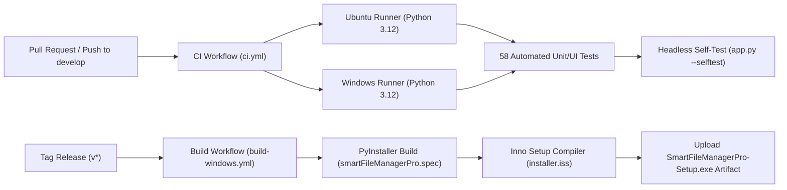

# Smart File Manager Pro — CI/CD & Build Guide

**Document Version:** 1.0.0
**Date:** 2026-11-10
**Lead DevOps Engineer:** ทัตพร สีโส (`team/dev`)

---

## 1. Overview of Automated Workflows

Smart File Manager Pro uses GitHub Actions for continuous integration, multi-platform test validation, and automated Windows binary distribution.



---

## 2. Workflows Description

### 2.1 Continuous Integration (`.github/workflows/ci.yml`)
- **Triggers:**
  - Pull requests to `develop` and `main`.
  - Pushes to `develop` and `team/*` branches.
  - Manual dispatch (`workflow_dispatch`).
- **Matrix:** `ubuntu-latest` and `windows-latest` on Python 3.12.
- **Key Tasks:**
  1. Installs headless Qt graphics dependencies on Linux (`libegl1`, `libgl1`, `libxkbcommon-x11-0`).
  2. Installs dependencies from `requirements.txt` and `requirements-dev.txt`.
  3. Executes the full 58 test suite under `QT_QPA_PLATFORM=offscreen`.
  4. Runs the headless application self-test (`python app.py --selftest`).

### 2.2 Release Build Packaging (`.github/workflows/build-windows.yml`)
- **Triggers:**
  - Push of version tags matching `v*` (e.g. `v4.3.0`).
  - Manual dispatch (`workflow_dispatch`).
- **Runner:** `windows-latest`
- **Key Tasks:**
  1. Installs dependencies and PyInstaller.
  2. Compiles application directory via `pyinstaller --noconfirm smartFileManagerPro.spec`.
  3. Installs Inno Setup via Chocolatey (`choco install innosetup --yes --no-progress`).
  4. Compiles Windows setup installer (`iscc installer.iss`).
  5. Uploads `SmartFileManagerPro-Setup.exe` as a workflow artifact.

---

## 3. Local Build Procedures

### Building the Windows Binary Package
Execute the local batch script on a Windows workstation:
```powershell
.\build_exe.bat
```
This generates the packaged bundle in `dist\SmartFileManagerPro\`.

### Creating the Inno Setup Installer
Ensure Inno Setup 6+ is installed, then compile `installer.iss`:
```powershell
iscc installer.iss
```
The resulting installer is saved to `Output\SmartFileManagerPro-Setup.exe`.
